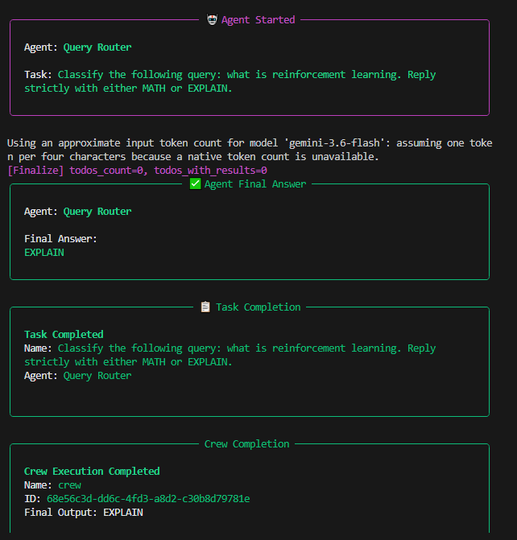
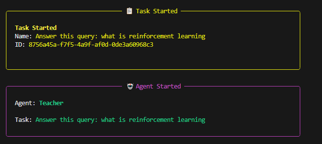
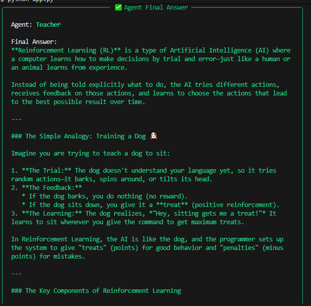
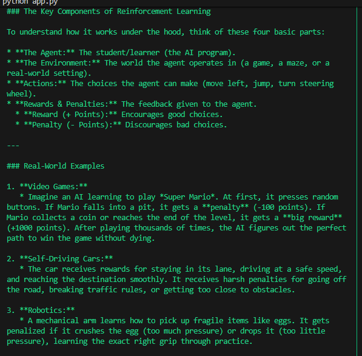
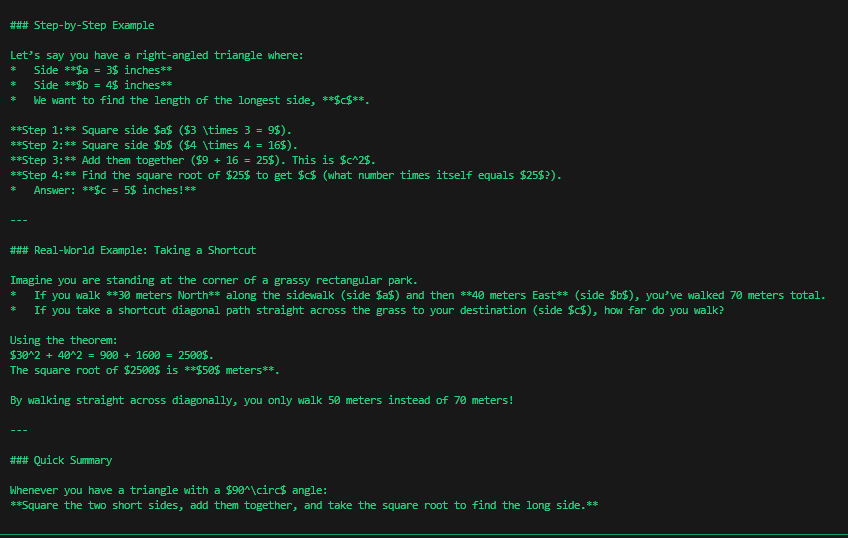

# 🤖 Multi-Agent Query Router with CrewAI & Google Gemini

A smart, lightweight multi-agent routing system built using **CrewAI**, **LiteLLM**, and **Google Gemini (`gemini/gemini-3.6-flash`)**. This project uses a **Query Router Agent** to dynamically classify user inputs and delegate tasks to specialized agents (a **Math Expert** or a **Teacher/Explanation Agent**).

---

## 🚀 Features

* **Dynamic Routing:** Automatically analyzes user intent to classify queries as either `MATH` or `EXPLAIN`.
* **Specialized Multi-Agent Workflow:**
    * *Query Router:* Directs traffic to the correct expert.
    * *Math Expert:* Solves complex mathematical problems step-by-step.
    * *Teacher:* Provides clear, concise, concept explanations with analogies.
* **Optimized & Stable:** Configured with LiteLLM and suppression flags to eliminate telemetry pauses and smooth out execution.

---

## 🛠️ Project File Structure

```text
crew/
│
├── venv/                 # Python virtual environment
├── .env                  # Environment configuration file (API keys)
├── .env.example          # Template for environment variables
├── .gitignore            # Git ignore file
├── app.py                # Main application script
└── requirements.txt      # Project dependencies
```

---

##  ⚙️ Installation & Setup
---
1. Clone the Repository & Navigate to Folder

   git clone https://github.com/MaryamArif85/Query-Agent
   cd crew

2. Create and Activate Virtual Environment

   python -m venv venv
   ### On Windows:
   venv\Scripts\activate
   ### On macOS/Linux:
   source venv/bin/activate

3. Install Dependencies

   pip install crewai python-dotenv "crewai[google-genai]"

4. Configure Your .env File

   copy .env.example

## 🏃‍♂️ Usage
Run the main Python script:
python app.py

---

A smart multi-agent routing system built using **CrewAI** and **Google Gemini**.

## 📸 Output





